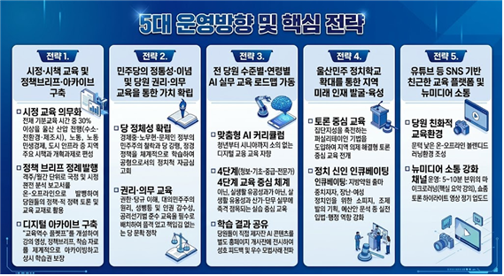
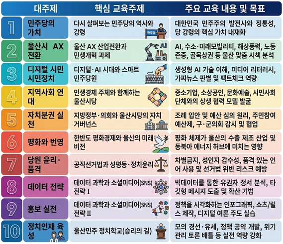
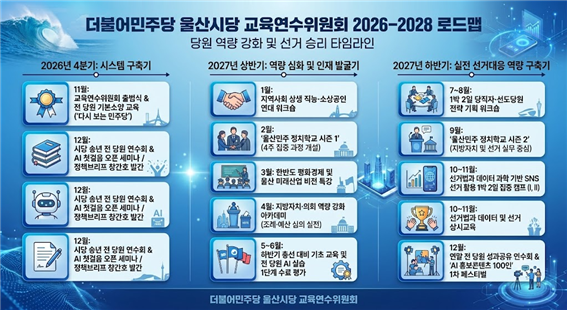
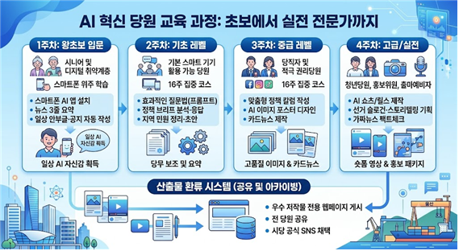
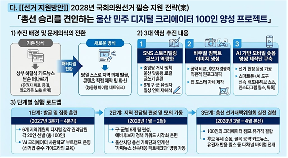

# 더불어민주당 울산광역시당 교육연수원 종합 운영계획

> **슬로건**: "깨어있는 당원, 실력 있는 민주당, 승리하는 울산시당"  
> **비전**: 민주주의 정통성과 AI 디지털 혁신 역량을 겸비한 선도당원 육성

---

## 1. 운영 목표 (4대 핵심 목표)

1. **당원 주권과 정통성 확립**
   - 민주당의 역사·철학·가치를 내재화하고, 당원의 권리와 의무를 명확히 인식하는 자긍심 높은 당원상 정립
2. **전국 시·도당 최초 '전 당원 AI 리터러시' 체계 구축**
   - 생성형 AI 등 첨단 디지털 도구를 전 당원이 자유롭게 활용하여 실생활과 당무, 선거에 능동적으로 참여하는 혁신 교육 모델 구현
3. **수권정당을 뒷받침하는 정책 역량 강화**
   - 울산 시정 및 5개 구·군 현안에 대한 정밀한 분석과 대안 제시 능력을 갖춘 풀뿌리 정책 당원 양성
4. **선거 승리를 견인하는 실전 조직력 확보**
   - 일방적 홍보 수용자를 넘어 스스로 지역 맞춤형 콘텐츠를 기획·생산·전파하는 정예 캠페이너를 배출하여 2028년 국회의원선거 승리 및 2030년 민주정부 수립의 확고한 교두보 마련

---

## 2. 5대 운영방향 및 핵심 전략



### [전략 1] 시정·시책 교육 및 정책브리프·아카이브 구축
- **시정 교육 의무화**: 전체 기본교육 시간 중 30% 이상을 울산 산업 전쟁(수소·친환경·제조AI), 노동, 노동 민생경제, 도시 인프라 등 지역 주요 시책과 개혁과제로 편성
- **정책 브리프 정례발행**: 격주/월간 단위로 국정 및 시정 현안 분석 보고서를 온·오프라인으로 발행하여 당원들의 정책·정무 토론 및 교육 교재로 활용
- **디지털 아카이브 구축**: "교육연수 플랫폼"을 개설하여 강의 영상, 정책브리프, 학습 자료를 체계적으로 아카이빙하고 상시 학습권 보장

### [전략 2] 민주당의 정통성·이념 및 당원 권리·의무 교육을 통한 가치 확립
- **당 정체성 확립**: 김대중·노무현·문재인 정부의 민주주의 철학과 당 강령, 정강 정책을 체계적으로 학습하여 당원으로서의 정치적 자긍심 고취
- **권리·의무 교육**: 권한·당규 이해, 대의민주주의 원리, 성평등 및 인권 감수성, 공직선거법 준수 교육을 필수로 배치하여 품격 있고 책임감 있는 당 문화 정착

### [전략 3] 전 당원 수준별·연령별 AI 실무 교육 로드맵 가동
- **맞춤형 AI 커리큘럼**: 청년부터 시니어까지 소외 없는 디지털 포용 교육 지향
- **4단계 교육 중심 체계 (입문-기초-중급-실전)**: 단순 이론 교육이 아닌, 실생활 유용성과 선거·당무 실무에 즉각 접목되는 실습 중심 교육
- **학습 결과 공유**: 당원들이 직접 제작한 AI 콘텐츠를 별도 홈페이지 게시판에 전시하여 상호 피드백 및 우수 모범사례 전파

### [전략 4] '울산민주 정치학교' 확대를 통한 지역 미래 인재 발굴·육성
- **토론 중심 교육**: 집단지성을 촉진하는 퍼실리테이션 기법을 도입하여 지역 의제 해결형 토론 중심 교육 전개
- **정치 신인 인큐베이팅**: 지방의원 출마 준비자, 청년·여성 정치인을 위한 스피치, 조례 발의 기획, 예산안 분석 등 실전 입법·행정 역량 강화

### [전략 5] 유튜브 등 SNS 기반 친근한 교육 플랫폼 및 뉴미디어 소통
- **당원 친화적 교육환경**: 문턱 낮은 온·오프라인 블렌디드 러닝(Blended Learning) 환경 조성
- **뉴미디어 소통 강화**: 5~10분 분량의 마이크로러닝(핵심 요약 강의), 숏폼(유튜브 쇼츠, 릴스, 틱톡) 토론 하이라이트 영상 정기 업로드

---

## 3. 세부 운영계획

### (1) 주제별 운영계획: 울산시당 10대 핵심 교육주제



| 번호 | 대주제 | 핵심 교육주제 | 주요 교육 내용 및 목표 |
|:---:|:---|:---|:---|
| **1** | **민주당의 가치** | 다시 살펴보는 민주당의 역사와 강령 | 대한민국 민주주의 발전사와 정통성, 당 강령의 핵심 가치 내재화 |
| **2** | **울산시 AX 전환** | 울산 AX 산업전환과 민생개혁 과제 | AI, 수소·미래모빌리티, 해상풍력, 노동존중, 골목상권 등 울산 맞춤 시책 분석 |
| **3** | **디지털 시민정치** | 디지털·AI 시대와 스마트 민주당원 | 생성형 AI 기술 이해, 미디어 리터러시, 가짜뉴스 판별 및 팩트체크 역량 |
| **4** | **지역사회 연대** | 민생경제 주체와 함께하는 울산시당 | 중소기업, 소상공인, 문화예술, 시민사회단체와의 상생 협력 모델 발굴 |
| **5** | **자치분권 실천** | 지방정부·의회와 울산시당의 자치 거버넌스 | 조례 입안 및 예산 심의 원리, 주민참여예산제, 구·군의회 감시 및 협업 |
| **6** | **평화와 번영** | 한반도 평화경제와 울산의 미래 비전 | 평화 체제가 울산의 수출 제조 산업 및 동북아 에너지 허브에 미치는 영향 |
| **7** | **당원 윤리·품격** | 공직선거법과 성평등·정치윤리 | 차별금지, 성인지 감수성, 품격 있는 언어 사용 및 선거법 위반 리스크 예방 |
| **8** | **데이터 전략** | 데이터 과학과 소셜미디어(SNS) 전략 I | 빅데이터를 통한 유권자 정서 분석, 타깃형 메시지 도출 및 확산 기법 |
| **9** | **홍보 실전** | 데이터 과학과 소셜미디어(SNS) 전략 II | 정책을 시각화하는 인포그래픽, 쇼츠/릴스 제작, 디지털 여론 주도 실습 |
| **10** | **정치인재 육성** | 울산민주 정치학교 (승리의 길) | 모의 경선·유세, 정책 공약 개발, 위기관리 토론 배틀 등 실전 역량 강화 |

---

### (2) 기간별 운영계획: 2026-2028 중장기 로드맵



#### 1단계: 시스템 구축기 (2026년 4분기)
- **11월**: 교육연수위원회 출범식 & 전 당원 기본소양 교육 ('다시 보는 민주당')
- **12월**: 시당 송년 전 당원 연수회 & AI 첫걸음 오픈 세미나 / 정책브리프 창간호 발간

#### 2단계: 역량 심화 및 인재 발굴기 (2027년 상반기)
- **1월**: 지역사회 상생 직능·소상공인 연대 워크숍
- **2월**: '울산민주 정치학교 시즌 1' (4주 집중 과정 개설)
- **3월**: 한반도 평화경제 및 울산 미래산업 비전 특강
- **4월**: 지방자치·의회 역량 강화 아카데미 (조례·예산 심의 실전)
- **5~6월**: 하반기 총선 대비 기초 교육 및 전 당원 AI 실습 1단계 수료 평가

#### 3단계: 실전 선거대응 역량 구축기 (2027년 하반기)
- **7~8월**: 1박 2일 당직자·선도당원 전략 기획 워크숍
- **9월**: '울산민주 정치학교 시즌 2' (지방자치 및 선거 실무 중심)
- **10~11월**: 선거법과 데이터 과학 기반 SNS 선거 활용 1박 2일 집중 캠프 (I, II) / 선거법과 데이터 및 선거 상시교육
- **12월**: 연말 전 당원 성과공유 연수회 & 'AI 홍보콘텐츠 100인' 1차 페스티벌

---

### (3) [핵심 특화과정] 전 당원 수준별·단계별 AI 활용 교육 운영안



#### 교육 운영 원칙
1. **실생활의 편리함** (스마트폰 앱 활용, 문서 요약, 일상 글쓰기)으로 흥미 유도
2. **당무 및 정책 활동** (현안 분석, 데이터 기반 당원 소통)으로 확장
3. **실전 선거 홍보물 제작 능력** (카드뉴스, 인포그래픽, 숏폼 영상)으로 완성
- 매월 정례화된 순환 교육 및 16주 집중 단계별 코스 병행

#### 단계별 교육 커리큘럼
| 단계 | 교육 대상 | 학습 방식 및 주차 | 주요 교육 내용 | 달성 목표 |
|:---|:---|:---|:---|:---|
| **1주차: 왕초보 입문** | 시니어 및 디지털 취약계층 당원 | 스마트폰 위주 실습 | · 스마트폰 AI 앱 설치<br>· 뉴스 3줄 요약<br>· 일상 안부글 및 공지 자동 작성 | **일상 AI 자신감 획득** |
| **2주차: 기초 레벨** | 기본 스마트 기기 활용 가능 당원 | 16주 집중 코스 | · 효과적인 질문법 (프롬프트 엔지니어링 기초)<br>· 정책 브리프 분석 및 질의응답<br>· 지역 민원 내용 정리 및 초안 작성 | **당무 보조 및 요약** |
| **3주차: 중급 레벨** | 당직자 및 적극 권리당원 | 16주 집중 코스 | · 맞춤형 정책 칼럼 작성<br>· AI 이미지 포스터 디자인<br>· 카드뉴스 콘텐츠 기획 및 제작 | **고품질 이미지 & 카드뉴스 제작** |
| **4주차: 고급/실전** | 청년당원, 홍보위원, 지방선거 출마예비자 | 심화 실전 코스 | · AI 쇼츠/릴스 숏폼 영상 제작<br>· 선거 슬로건 및 감성 스토리텔링 기획<br>· 가짜뉴스 팩트체크 및 신속 대응 실습 | **숏폼 영상 & 홍보 패키지 완성** |

#### 산출물 환류 시스템 (공유 및 아카이빙)
- 당원이 교육 중 제작한 콘텐츠를 **교육연수원 홈페이지 내 우수작 갤러리**에 등록
- 우수 콘텐츠는 시당 공식 SNS(유튜브, 인스타그램, 페이스북) 채택 및 전 당원 확산

---

### (4) [선거 지원방안] 2028년 국회의원선거 필승 지원 전략(案)
> **프로젝트명**: 「총선 승리를 견인하는 울산 민주 디지털 크리에이터 100인 양성 프로젝트」



#### 1) 추진 배경 및 문제의식의 패러다임 전환
- **기존 방식의 한계**: 상부 하달식 카드뉴스 단순 퍼나르기 ➔ 유권자 피로도 증대, SNS 알고리즘 노출 한계 봉착
- **새로운 패러다임**: 당원 스스로 울산 지역 의제를 발굴하고 직접 맞춤형 콘텐츠를 제작·확산하는 **능동형 바이럴 네트워크** 구축

#### 2) 3대 핵심 추진 내용
1. **SNS 스토리텔링 글쓰기 역량화**
   - 중앙당 거시 정책을 울산 맞춤형 로컬 글쓰기로 전환 훈련
   - 울산 5개 구·군 유권자의 일상 언어로 재해석하여 친근한 메시지 전파
2. **비주얼 임팩트 이미지 생성**
   - 후보자 간 공약 비교 및 차별화 포인트 시각화
   - 직관적인 인포그래픽 및 모바일 웹 포스터 자체 디자인
3. **AI 기반 모바일 숏폼 영상 제작단 구축**
   - 현장 유세 및 민생 탐방 음성/영상 가공
   - 스마트폰과 AI 비디오 제작 도구를 결합하여 24시간 내 신속 배포 (유튜브 쇼츠, 인스타그램 릴스, 틱톡)

#### 3) 단계별 실행 로드맵
```
[1단계: 발굴 및 집중 훈련] (2027년 3분기 ~ 4분기)
  └─ 6개 지역위원회별 디지털 감각 권리당원 각 20인 선발 (총 100인)
  └─ 'AI 크리에이터 사관학교' 부트캠프 운영 (공직선거법 준수 가이드라인 집중 교육)
       ▼
[2단계: 지역 전담팀 편성 및 모의 가동] (2028년 1월 ~ 2월)
  └─ 구·군별 6개 지역 전담팀 편성 및 예비후보자 정책 키워드 시각화 훈련
  └─ 울산시당 총선 기획단과 연계한 '가짜뉴스 신속대응 팩트체크단' 병행 가동
       ▼
[3단계: 총선 선거대책위원회 실전 결합] (2028년 3월 ~ 4월 본선)
  └─ 100인의 크리에이터 캠프를 시당 선대위 공식 미디어 홍보단과 유기적 결합
  └─ 후보 유세 숏폼, 골목 공약 카드뉴스, 유권자 반응 릴스 등 다채널 바이럴 전개
```
