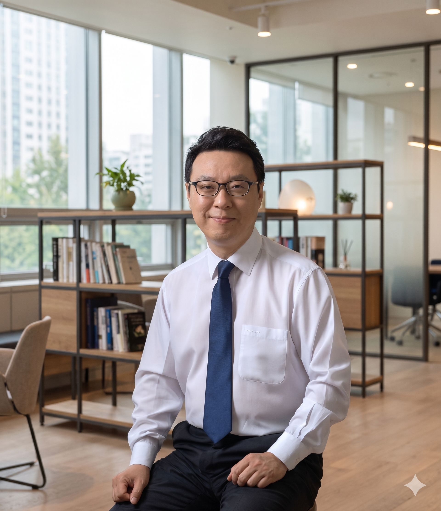

# 더불어민주당 울산광역시당 교육연수위원장 인사말 및 소개



> **"1443년 세종대왕께서 훈민정음으로 백성의 눈을 틔웠듯,  
> 2026년 우리는 AI를 당원의 무기로 삼아 '모두가 잘 사는 대동세상'의 문을 열겠습니다."**  
> — **더불어민주당 울산광역시당 교육연수위원장 정우진**

---

## 1. 교육연수위원장 공식 인사말 (정제본)

### 존경하고 사랑하는 더불어민주당 울산광역시당 당원동지 여러분!  
그리고 울산의 새로운 미래를 함께 꿈꾸는 울산시민 여러분, 반갑습니다.  
**더불어민주당 울산광역시당 교육연수위원장 정우진**입니다.

지금 우리는 인류 문명사적 대전환기인 **'AI(인공지능) 혁명의 한복판'**에 서 있습니다.  
증기기관과 전기가 산업의 판도를 바꾸었듯, 생성형 AI와 디지털 혁신은 이미 우리의 일자리와 경제, 정치 지형을 송두리째 뒤흔들고 있습니다.

이 거대한 문명사 변환의 기로에서, 더불어민주당의 사명은 명확합니다.  
우리는 소수 기득권과 대기업만이 독식하는 불평등한 경제가 아니라, **중산층과 서민이 중심이 되는 따뜻한 경제**, 누구에게나 기회가 활짝 열려 있는 **공정한 사회**를 만들어야 합니다. 이것이 바로 이재명 정부가 지향하는 **'모두가 함께 잘 사는 대동세상(大同世上)'**의 길이며, 우리 당원동지들이 한마음 한뜻으로 나아가야 할 시대적 소명입니다.

### 낡은 투쟁론을 넘어, 실력과 대안의 정치로 나아갑니다.

사회의 복잡다단한 갈등과 민생 문제는 단순한 진영 논리나 거친 투쟁, 어설픈 생물학적 비유(침팬지론·곤충론) 따위로는 결코 풀어낼 수 없습니다.  
정치는 문제에 대한 '해결책'을 내놓아야 하며, 그 해결책은 냉철한 현실 분석과 시대정신을 담은 실력에서 나옵니다.

1443년 세종대왕께서 한글을 창제하신 참뜻은 지배층의 권력이었던 문자를 백성들의 손에 쥐여주어 그들의 삶을 풍요롭게 하고 스스로 삶의 주인이 되게 하기 위함이었습니다.  
오늘날의 **AI 역시 인간의 삶과 존엄을 풍요롭게 만드는 강력한 민주주의의 도구**여야 합니다. 소수의 전유물이 아니라, 깨어있는 보통 시민과 당원 모두가 다룰 수 있는 실질적인 역량이 되어야 합니다.

### 울산시당을 전국 최고의 '스마트 선도정당'으로 세우겠습니다.

울산은 대한민국 산업 수도입니다. 제조업과 에너지 산업의 대전환(AX·AI Transformation)이 가장 숨 가쁘게 일어나는 혁신의 현장입니다.  
우리 울산시당 교육연수원은 당원 여러분께서 단순히 당의 결정을 소비하는 수동적 객체에 머무르지 않고, **시대의 최전선에서 대한민국을 선도하는 당당한 주권자**로 우뚝 설 수 있도록 뒷받침하겠습니다.

- **기초부터 실전까지 빈틈없는 '전 당원 AI 리터러시' 체계**를 완성하겠습니다.
- 울산의 현안을 꿰뚫고 대안을 제시하는 **'풀뿌리 정책 전문가'**를 길러내겠습니다.
- 당원 스스로 콘텐츠를 만들고 여론을 주도하는 **'100인의 디지털 크리에이터'**를 양성하여 2028년 총선 승리와 민주정부 수립의 주역으로 세우겠습니다.

기술은 당원의 손끝에서 민주주의의 불꽃으로 타오를 것입니다.  
당원이 주인이 되는 민주당, 승리하는 울산시당을 위해 교육연수위원장으로서 늘 당원동지 여러분의 곁에서 가장 뜨겁게 발로 뛰겠습니다.

감사합니다.

**더불어민주당 울산광역시당 교육연수위원장 정 우 진**

---

## 2. 정우진 위원장의 5대 철학 및 교육 방향

```
┌─────────────────────────────────────────────────────────────┐
│              정우진 위원장의 5대 교육 철학                    │
├─────────────────────────────────────────────────────────────┤
│ 1. 문명사적 AI 대전환기: 중산층·서민 중심의 당 정체성 확립 │
│ 2. 이재명 정부 국정철학 연대: 모두가 잘 사는 대동세상 실현 │
│ 3. 세종대왕 훈민정음 정신 계승: 인간을 풍요롭게 하는 AI 도구│
│ 4. 낡은 도식적 투쟁 탈피: 실력과 데이터 기반의 문제해결    │
│ 5. 당원 주권의 완성: 울산 AX 선도 및 실전 정치인재 육성   │
└─────────────────────────────────────────────────────────────┘
```

1. **AI 문명 대전환과 서민·중산층 정당**
   - 대기업과 소수 기술 독점 세력에 의한 양극화를 방지하고, 모든 시민에게 기술 혜택과 열린 기회가 주어지도록 교육 복지 실현
2. **이재명 정부와 '대동세상(大同世上)'의 지향**
   - 불평등과 격차를 해소하고 공동체 모두가 풍요를 누리는 국정철학을 당원 교육의 근본 정신으로 내재화
3. **1443년 세종대왕 훈민정음 정신의 현대적 계승**
   - 한글이 백성을 문자 권력으로부터 해방시켰듯, AI 리터러시를 통해 전 당원을 디지털 정보 권력의 주체로 무장
4. **교조주의적 투쟁론 극복과 실사구시(實事求是)**
   - 단순 구호성 투쟁이나 낡은 논리(침팬지론·곤충론 등)를 배격하고, 복잡한 사회 문제를 해결할 과학적 데이터·정책 역량 함양
5. **울산형 AX(AI 전환) 선도와 능동적 당원 주권**
   - 제조업 중심 울산의 산업적 특성을 반영한 실전 AI 교육을 통해 당원을 지역 혁신의 선봉장으로 육성

---

## 3. 원문 메모 (초안 아카이브)

> **[원문 초안]**  
> 더불어민주당은 AI 전환이라는 문명사 변환 시점에 중산층과 서민의 정당으로 자리매김해야 한다. 정치노선 투쟁에서 이재명 정부가 추구하는 모두가 잘 사는 대동세상을 위해 함께 동지적 자세로 이와 함께 해가야 한다. 대전환의 시대에 일부 대기업만 잘 사는 세상이 아니라 모두가 함께 열린 기회의 장을 열어야 한다.  
> 
> 단순한 투쟁적이고, 어설픈 침팬지론이나 곤충론으로 이 사회의 복잡 다단한 문제를 풀 수 없다. 1443년에 세종대왕께서 한글을 창제했다. AI는 인간의 삶을 풍요롭게 하는 도구여야 한다. AI 전환시대에 더불어민주당 당원들에게 AX 전환기에 대한민국을 선도할 수 있도록 더불어민주당 울산시당의 당당한 주인으로 자리매김 할 수 있도록 교육연수원 위원장으로써 당원과 함께 나아가겠다.

---

## 4. 홈페이지 화면 구현 가이드 (UI Component)

### [웹 페이지 배치안: `/about/greeting` 또는 `/about/director`]
1. **상단 히어로 배너**:
   - 정우진 위원장의 슬로건 캐치프레이즈 (세종대왕 훈민정음 인용구)
   - 블루 그라데이션 및 신뢰감 있는 타이포그래피
2. **원장 프로필 & 인사말 2단 레이아웃 (데스크톱 기준)**:
   - **좌측 (1/3)**: 
     - 원장 고해상도 프로필 사진 (`JWJ_Profile_Image.png`)
     - 직함: 더불어민주당 울산광역시당 교육연수위원장
     - 약력 및 활동 키워드 뱃지 (`#AI혁신`, `#당원주권`, `#대동세상`, `#울산AX선도`)
   - **우측 (2/3)**:
     - 인사말 정제본 전문 텍스트
     - 단락별 소제목과 감성적인 인용 부호 디자인 적용
     - 친필 서명 이미지 또는 정갈한 명기 (`더불어민주당 울산광역시당 교육연수위원장 정우진`)
3. **하단 핵심 3대 약속 카드**:
   - `[약속 1]` 전 당원 맞춤형 AI 리터러시 100% 달성
   - `[약속 2]` 당원의 목소리를 담은 풀뿌리 정책 아카이브 운영
   - `[약속 3]` 2028 총선 승리를 위한 디지털 크리에이터 100인 육성
