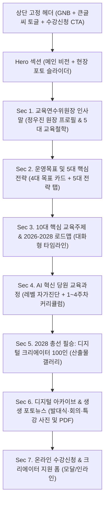

# 더불어민주당 울산시당 교육연수원 홈페이지 제작 마스터 플랜

> **프로젝트명**: 더불어민주당 울산광역시당 교육연수원 공식 디지털 플랫폼 구축  
> **디자인 테마**: Clean White & Trust Blue Spectrum (화이트 배경 + 4단계 블루·네이비 타이포그래피/UI 시스템)  
> **핵심 슬로건**: *"깨어있는 당원, 실력 있는 민주당, 승리하는 울산시당"*

---

## 1. 디자인 & 컬러 시스템 (White & 4-Tone Blue Typography)

요청하신 **순백색(White) 배경**을 기본 바탕으로 하여, 콘텐츠의 위계(Hierarchy)와 가독성을 극대화하는 **4단계 블루·네이비 스펙트럼**을 폰트 및 포인트 컬러로 적용합니다.

| 구분 | 컬러 명칭 | HEX 코드 | 적용 영역 (폰트 및 UI 요소) |
| :--- | :--- | :---: | :--- |
| **Base Background** | **Pure White** | `#FFFFFF` | 전체 메인 배경, 카드 컨테이너 기본 배경 |
| **Sub Background** | **Ice White Blue** | `#F4F8FD` | 섹션 구분 배경, 인용구 박스, 호버(Hover) 배경 |
| **Font / Accent 1** | **Navy Deep Blue (네이비 딥블루)** | `#0A192F` | **대제목(H1, H2), 본문 핵심 텍스트** (최고 가독성 및 무게감) |
| **Font / Accent 2** | **Navy Blue (네이비 블루)** | `#1B365D` | **중제목(H3), GNB 메뉴 텍스트, 카드 타이틀, 인용문 본문** |
| **Font / Accent 3** | **Primary Blue (민주 블루)** | `#004EA2` | **핵심 강조 텍스트, 주요 버튼(CTA), 탭 활성화, 아이콘, 배지** |
| **Font / Accent 4** | **Blue Sky (블루스카이)** | `#00A3E0` | **서브 헤드라인, AI·디지털 특화 키워드 강조, 태그, 보더 라인** |

> [!TIP]
> **시니어 친화적 가독성 설계**
> - 본문 기본 크기를 `17px~18px`(행간 `1.75`)로 넉넉하게 설정하고, 상단 네비게이션 바에 **[큰 글씨 모드(A+)]** 토글 버튼을 배치하여 시니어 당원도 눈의 피로 없이 열람할 수 있도록 구현합니다.
> - 한글 웹폰트는 가독성이 뛰어난 **Pretendard**와 격조 있는 명조 계열(**Noto Serif KR**, 원장 인사말 인용구용)을 조합합니다.

---

## 2. 홈페이지 전체 구조 및 섹션 설계 (Information Architecture)

단일 페이지에서도 모든 핵심 내용을 막힘없이 탐색할 수 있는 **모던 원페이지 스크롤 + 탭 전환 하이브리드 웹앱 구조**로 설계하여, 이미지와 문서 자산이 입체적으로 보이도록 구성합니다.

---

## 3. 기존 보유 자산(Assets) 100% 매핑 계획

현재 워크스페이스(`c:\GL-AG-PJT\MJEdu`)에 준비된 모든 이미지와 문서를 각 섹션에 최적화하여 배치합니다.

| 섹션 위치 | 활용 파일 경로 | 화면 연출 방식 |
| :--- | :--- | :--- |
| **Hero 배너 / 포토뉴스** | `교육연수원발대식.jpg`, `김민석대표.jpg`, `회의사진.jpg` | 고해상도 비주얼 슬라이더 및 현장 갤러리 라이트박스(클릭 시 확대) |
| **정우진 원장 인사말** | [`JWJ_Profile_Image.png`](file:///c:/GL-AG-PJT/MJEdu/assets/images/JWJ_Profile_Image.png), `정우진1~4.jpg`, [`03_교육연수위원장_인사말_및_소개.md`](file:///c:/GL-AG-PJT/MJEdu/docs/03_교육연수위원장_인사말_및_소개.md) | 좌측 프로필 카드 + 활동 스냅샷 4종 미니 갤러리 + 우측 정제본 인사말 & 5대 철학 아코디언 |
| **5대 핵심전략** | [`01_5대_운영방향_및_핵심전략.png`](file:///c:/GL-AG-PJT/MJEdu/assets/images/01_5대_운영방향_및_핵심전략.png) | 인터랙티브 5단 카드 그리드 + 원본 인포그래픽 한눈에 보기 모달 |
| **10대 교육주제** | [`02_울산시당_10대_핵심_교육주제.png`](file:///c:/GL-AG-PJT/MJEdu/assets/images/02_울산시당_10대_핵심_교육주제.png) | 분야별 필터링 가능한 10대 주제 카드 테이블 + 검색 기능 |
| **2026-2028 로드맵** | [`03_교육연수위원회_2026_2028_로드맵.png`](file:///c:/GL-AG-PJT/MJEdu/assets/images/03_교육연수위원회_2026_2028_로드맵.png) | 분기별 탭 전환 타임라인 UI (2026 4분기 / 2027 상반기 / 2027 하반기) |
| **AI 혁신 교육과정** | [`04_AI_혁신_당원_교육과정.png`](file:///c:/GL-AG-PJT/MJEdu/assets/images/04_AI_혁신_당원_교육과정.png) | **[나에게 맞는 AI 과정 찾기]** 3문항 진단 위젯 + 1~4주차 코스 안내 + 환류 시스템 다이어그램 |
| **디지털 크리에이터 100인** | [`05_총선승리_디지털크리에이터100인_양성프로젝트.png`](file:///c:/GL-AG-PJT/MJEdu/assets/images/05_총선승리_디지털크리에이터100인_양성프로젝트.png) | 기존 vs 새로운 패러다임 비교 UI + 3대 추진내용 + 3단계 로드맵 |
| **정책브리프 & 자료실** | `261021_교육연수원 제1차회의 결과V2.pdf` | 제1차 회의 결과 요약 뷰어 및 원본 PDF 즉시 다운로드 버튼 |

---

## 4. 기술 구현 아키텍처 및 단계별 실행 계획

별도의 복잡한 서버 설치 없이 브라우저에서 즉시 실행·검증할 수 있으면서도 향후 서버 확장이 용이한 **반응형 웹 애플리케이션 구조**로 제작합니다.

### Phase 1: 기반 구조 및 화이트·블루 디자인 시스템 구축
- `c:\GL-AG-PJT\MJEdu\index.html`, `css/style.css`, `js/main.js` 생성
- CSS 변수(`--navy-deep`, `--navy-blue`, `--blue-primary`, `--blue-sky`, `--bg-white`)로 4단계 블루 폰트·테마 시스템 정의
- 모바일/태블릿/데스크톱 완벽 대응 반응형 그리드 및 **큰 글씨 모드(Font Scale Toggle)** 구현

### Phase 2: 핵심 콘텐츠 섹션 구현
1. **헤더 & 히어로 섹션**: 슬로건 애니메이션, 주요 지표 카운터(10대 핵심주제, 4단계 AI 교육, 100인 크리에이터, 5개 구·군 연대)
2. **정우진 교육연수위원장 인사말 섹션**: 프로필 사진, 세종대왕 훈민정음 & 대동세상 캐치프레이즈, 인사말 전문(접기/펼치기 지원), 활동 사진(`정우진1~4.jpg`) 갤러리
3. **비전·목표·5대 핵심전략 섹션**: 4대 운영목표 아이콘 카드 및 5대 전략 상세 탭

### Phase 3: 대화형(Interactive) 교육·로드맵·아카이브 기능 구현
1. **10대 교육주제 탐색기**: 키워드/분류별 필터 및 상세 모달
2. **AI 교육 레벨 자가진단기**: 당원이 3가지 질문에 답하면 `1주차 왕초보 입문` ~ `4주차 고급/실전` 중 맞춤 과정을 추천하고 수강신청 폼으로 자동 연결
3. **인포그래픽 원본 뷰어(Lightbox)**: 첨부된 5장의 인포그래픽 이미지를 클릭 시 고해상도로 확대해서 볼 수 있는 모달 뷰어 탑재
4. **제1차 회의결과 아카이브 & 포토뉴스**: `교육연수원발대식.jpg`, `김민석대표.jpg`, `회의사진.jpg` 현장 갤러리 및 PDF 다운로드 연결
5. **온라인 수강신청 / 크리에이터 100인 지원 모달**: 성명, 지역위원회(중구/남구갑/남구을/동구/북구/울주군), 희망 과정 선택 및 신청 완료 인터랙션

### Phase 4: 브라우저 검증 및 최적화
- 모든 이미지 로드 상태, 텍스트 대비(화이트 배경 위 네이비/블루 가독성), 모바일 반응형 레이아웃, 인터랙티브 탭/모달 동작 검증
